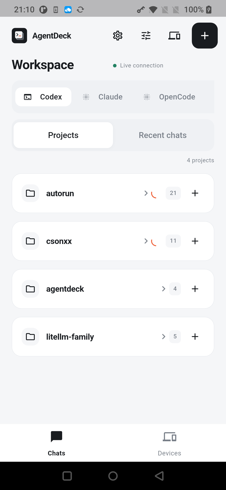
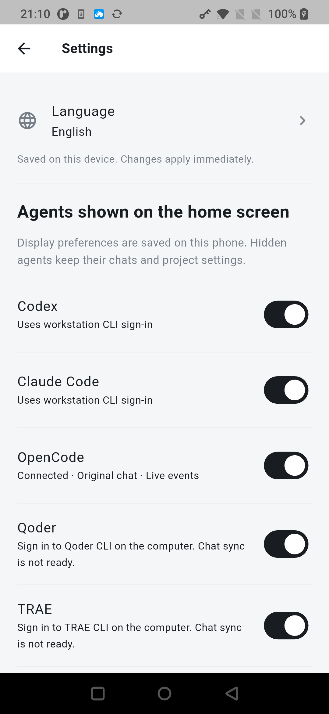

# AgentDeck · 会话甲板

在手机上查看和继续电脑上的 coding agent 会话。支持 Codex、Claude Code、OpenCode、Qoder、TRAE、WorkBuddy，电脑运行 Go 后端，手机使用 Flutter 原生 App。

当前版本 **0.4.15** · [源码仓库](https://gitlab.ttyuyin.com/azeroth/agentdesk)

## 能做什么

- 按 Agent、项目或最近会话浏览，搜索历史并跳到指定消息。
- 新建、发送、续聊、停止和工具审批，具体能力取决于 Agent。
- 查看 Markdown、思考摘要、工具输出、图片与文件；支持 Office 内容预览和音视频播放。
- 手机端语音转文字，编辑后手动发送；支持图片和文件附件。
- 手机与工作站之间加密通信，可直连，也可通过飞书网关发现工作站和中继。

WorkBuddy 当前只提供每个账号的一个本地助理；各 Agent 的接入要求见 [接入指南](docs/AGENTS.md)。

## 界面

以下为 Android 0.4.13 真机截图，项目组已折叠以隐藏私人会话。

<p>
  
  
</p>

## 快速上手：Android USB 直连

需要 Go 1.25+、Flutter 3.38+ / Dart 3.10+、Python 3、Android SDK/JDK，以及开启 USB 调试的 Android 7.0+ 手机。在运行后端的同一系统用户下安装并登录 Codex 或 Claude Code。

**1. 克隆并构建**

```sh
git clone git@gitlab.ttyuyin.com:azeroth/agentdesk.git
cd agentdesk
mkdir -p artifacts
(cd backend && GOWORK=off go build -o ../artifacts/agentdeck.next ./cmd/agentdeck)
mv artifacts/agentdeck.next artifacts/agentdeck
(cd app && flutter pub get)
python3 scripts/setup_client_voice.py
(cd app && flutter build apk --release --split-per-abi)
adb -s DEVICE_SERIAL install -r app/build/app/outputs/flutter-apk/app-arm64-v8a-release.apk
```

把 `DEVICE_SERIAL` 换成 `adb devices` 中的设备编号。语音模型首次下载约 300 MB，随 App 打包；当前 APK 使用开发测试签名。

**2. 在电脑启动后端**

将 `$HOME/workspace` 换成实际项目父目录，以下命令从仓库根目录执行，并保持运行：

```sh
./artifacts/agentdeck serve \
  --data "$HOME/.agentdeck" \
  --listen 127.0.0.1:8443 \
  --public-url https://localhost:8443 \
  --codex-sessions "$HOME/.codex/sessions" \
  --claude-sessions "$HOME/.claude/projects" \
  --project-roots "$HOME/workspace" \
  --media-roots "$HOME/workspace"
```

日志目录用于导入历史，`--project-roots` 用于允许手机新建和发送。若要发送到电脑上已打开的 Codex 原会话，给启动命令增加 `--codex-desktop-socket "$HOME/.codex/ipc/ipc.sock"`；未配置时通过手机分支续聊，原会话的停止和审批仍在电脑处理。

**3. 在另一个终端配对**

```sh
adb -s DEVICE_SERIAL reverse tcp:8443 tcp:8443
./artifacts/agentdeck pair --data "$HOME/.agentdeck" --out /tmp/agentdeck-pair
```

打开生成的 `/tmp/agentdeck-pair.png`，在 App 扫码，也可粘贴 JSON。配对码 5 分钟内有效、单次使用，配对后删除 `.png` 和 `.json`。手机连接后，选 Agent → 项目 → 打开或新建会话 → 发送。

USB 断开或电脑休眠会中断连接；重接后再执行 `adb reverse`，已有配对可继续使用。日常通过 Wi-Fi 或移动网络使用，请配置下面的公网连接。

## 公网连接

| 方式 | 适用情况 | 配置 |
| --- | --- | --- |
| HTTPS 直连 | 手机连接自己的工作站；Envoy 持有域名证书 | [部署指南](docs/deploy/README.md) |
| 飞书网关 | 多租户发现工作站，工作站只需主动连出；网关只中继密文 | [网关指南](docs/GATEWAY.md) |

飞书应用的最小配置：启用网页登录能力，在安全设置登记 `https://你的网关域名/v2/auth/callback`，将使用者加入应用可用范围，并发布应用。App ID / App Secret 只配置在 S-GATEWAY；电脑与手机使用同一个应用、同一个飞书账号登录。

当前仅通过 `user_info` 读取租户标识、用户标识和姓名，**无需额外 API 权限，`FEISHU_OAUTH_SCOPE` 留空即可**。无需通讯录、手机号、邮箱、消息/机器人权限或 `offline_access`。官方接口的权限要求见 [获取授权码](https://open.feishu.cn/document/authentication-management/access-token/obtain-oauth-code)和[获取用户信息](https://open.feishu.cn/document/server-docs/authentication-management/login-state-management/get)；详细配置及跨企业使用限制见[网关指南](docs/GATEWAY.md)。

测试网关地址为 `https://web-test-omnivibe.ttyuyin.com/agentdeck`；电脑 `local-login --gateway-url` 和 App 网关登录都填完整地址。飞书回调为该地址加 `/v2/auth/callback`。CICD 构建、NAS 子目录和 VS 配置见[测试部署指南](docs/deploy/TESTING.md)。

测试网关已配置飞书应用，真实电脑端登录及工作站在线已验证。电脑以 `serve --relay` 启动，再打开下面的本机管理页面；首次在页面中关联网关，已有绑定会自动沿用。App 用同一飞书账号登录、选择工作站，在电脑页面输入手机的校验码并批准。App 重置后需要重新配对。完整步骤见[网关指南](docs/GATEWAY.md)，验收范围见[测试验收记录](docs/deploy/ACCEPTANCE-2026-10-10.md)。

The testing gateway uses `https://web-test-omnivibe.ttyuyin.com/agentdeck`. Enter the full URL, including the prefix, in S-LOCAL and the app. Register this URL plus `/v2/auth/callback` in Feishu. See the [testing deployment guide](docs/deploy/TESTING.md).

The testing gateway now has Feishu configured; real workstation sign-in and its online tunnel have been verified. Start `serve --relay`, then open workstation controls below to link through Feishu; saved associations reconnect automatically. Sign in to the app with the same Feishu account, select the workstation, and enter the phone comparison code on the computer to approve pairing. Resetting the app requires a new pairing. See the [gateway guide](docs/GATEWAY.md) and [acceptance record](docs/deploy/ACCEPTANCE-2026-10-10.md).

### 电脑管理页面 / Workstation controls

保持本地后端运行，另开终端执行（`--data` 必须与后端一致）：

Keep the local backend running and execute this in a second terminal, using the same `--data` directory:

```sh
artifacts/agentdeck console --data "$HOME/.agentdeck"
# 本次电脑体验使用 / This workstation currently uses:
# artifacts/agentdeck console --data "$HOME/.agentdeck-usb"
```

自动打开本机页面，支持关联网关、飞书授权、实时查看在线/重连状态，以及填写手机 12 位校验码来批准配对。首次关联不再需要停后端执行 `local-login`。后端尚未关联时，`serve --relay` 会正常启动并等待网页关联。已有 `local-login` 命令保留供终端使用。

The browser opens local controls for gateway enrollment, Feishu authorization, live connection/reconnection status, and pairing approval with the phone's 12-character comparison code. First enrollment no longer requires stopping the backend. An unlinked `serve --relay` starts and waits for browser enrollment. `local-login` remains available for terminal workflows.

页面仅监听 `127.0.0.1`，使用独立随机访问凭据、同源校验及有限管理 API；不能通过公网网关或手机访问。终端关闭后页面服务结束。若浏览器未自动打开，打开命令打印的 `console-open-*.html` 私有启动文件；它只在本次页面服务运行期间有效，退出时删除。不要分享该文件或包含访问凭据的地址。详细步骤及日志排障见[本机管理指南](docs/WORKSTATION.md)。

Controls listen only on `127.0.0.1`, with a random access capability, origin checks and a restricted management API; the gateway and phones cannot access them. Keep the console process running. If the browser does not open, use the private `console-open-*.html` launcher printed by the command; it expires with the console process and is deleted on exit. Do not share the launcher or capability URL. See [workstation controls and diagnostics](docs/WORKSTATION.md).

iOS/macOS 也使用原生客户端，需 Xcode 与对应签名配置；不支持 Flutter Web。仅部署后端时只需 Go。

## 使用前了解

- 电脑已有会话的同步依赖源日志落盘；不代表所有桌面会话都能逐 token 同步。
- 已配对手机可以查看该工作站全部已导入会话，目前没有按项目细分的查看权限。
- App 一次保存一个工作站；网关目前只支持单节点。
- 升级时保留 `--data` 目录；替换后端程序后需要重启服务。

## 开发与文档

`backend/` 是 Go 后端，`app/` 是 Flutter 客户端，`docs/` 是配置和协议文档。完整检查运行：

```sh
./scripts/verify.sh
```

检查包含 Go race/vet、Flutter 分析、协议兼容与合成端到端测试；真实公网和飞书配置仍需在自己的环境验证。

- [Agent 接入与配置](docs/AGENTS.md)
- [模型、语音、图片与文件输入](docs/INPUTS.md)
- [Office 预览范围](docs/OFFICE_PREVIEW.md)
- [加密与授权](docs/SECURITY.md)
- [验收记录](docs/ACCEPTANCE.md)

当前未指定开源许可证。
