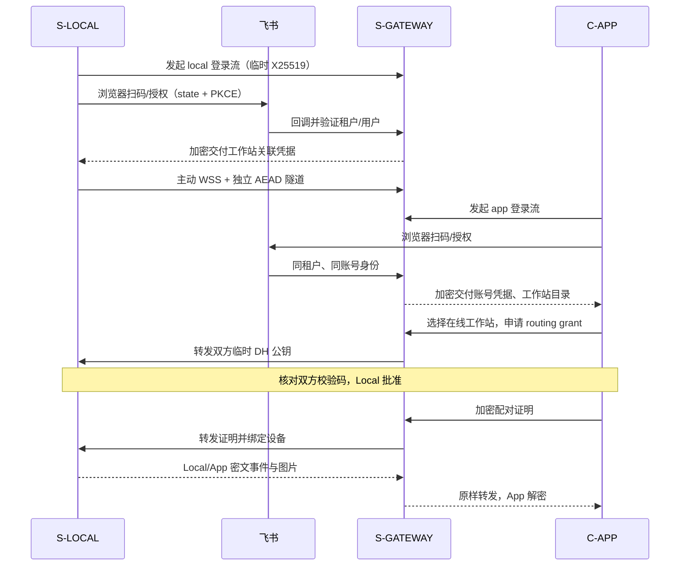

# AgentDeck 0.2.0 · 飞书网关模式

保留直连模式，新增三个角色。当前实现支持按项目会话同步、创建、发送、停止和显式审批；所有操作帧在 Local/App 之间加密，Gateway 不解析 agent 内容，首次关联用飞书确认身份，首次会话密钥用双方校验码确认。

| 角色 | 部署位置 | 职责 | 持有的密钥 |
| --- | --- | --- | --- |
| S-LOCAL | Codex / Claude 所在机器 | 读取/桥接会话、加密保存、主动连接网关 | 本机存储 key、网关 enrollment key、每个手机独立 root |
| S-GATEWAY | 公网 Envoy 后面的 Go 服务 | 飞书登录、租户/账号归属、在线工作站目录、透明中继 | 网关存储 key、enrollment/account/routing key；无会话 root |
| C-APP | Flutter Android / iOS | 飞书登录、选择工作站、校验、解密展示 | 安全存储内的 account/routing key、独立 root/cache key |



## 配置飞书应用

使用同一个飞书应用处理工作站与 App 登录。身份来自官方 user_info 的 tenant_key/open_id，不接受客户端提交租户/用户作为归属依据。企业自建应用只能服务其被允许的企业用户；跨企业使用需配置适用于对应租户的飞书应用类型、授权范围/安装，AgentDeck 的多租户路由不代替飞书的应用可用性配置。

在飞书开放平台为应用启用网页登录能力，并配置授权回调：

```text
https://agent.example.com/v2/auth/callback
```

在应用的“安全设置 → 重定向 URL”登记完整回调地址，即 `--public-url` 加 `/v2/auth/callback`。网关支持路径前缀，例如 `https://web-test-omnivibe.ttyuyin.com/agentdeck`；前缀各段只允许字母、数字、下划线和连字符，无末尾斜杠。VS 必须保留前缀转发，由网关剥离后处理协议路径。将使用者加入应用可用范围，并按应用类型完成版本发布/审核。

**当前登录无需额外 API 权限，`FEISHU_OAUTH_SCOPE` 留空即可。** 官方“获取授权码”和“获取用户信息”接口均标注“权限要求：无”；AgentDeck 只读取 `tenant_key`、`open_id`、`name`。无需开通 `contact:user.base:readonly`、`contact:user.id:readonly`、手机号/邮箱/完整通讯录或消息/机器人权限，也无需 `offline_access`。后者用于获取 refresh token，当前实现不需要。无需配置事件订阅、Verification Token 或 Encrypt Key；Local/App 的端到端加密使用 AgentDeck 自己的密钥协议。

浏览器打开 AgentDeck 登录页，二维码指向本网关授权入口；飞书扫码后在同一浏览器完成授权回调。同一手机也可以点“在飞书授权”，不必用相机扫描自己的屏幕。真实手机的飞书浏览器 Cookie/跳转兼容性待目标应用验收。

参考官方 [扫码登录介绍](https://open.feishu.cn/document/qr-code-scanning-login-for-web-app/introduction)、[OAuth 授权码](https://open.feishu.cn/document/authentication-management/access-token/obtain-oauth-code)、[获取用户身份](https://open.feishu.cn/document/server-docs/authentication-management/login-state-management/get)。当前使用 OAuth2 v2 token 交换和 v1 user_info；不获取或长期保存飞书 refresh token。

网关运行环境注入以下变量，App Secret 不写入仓库、不传给 App/Local、不发聊天。示例模板见 [gateway.env.example](deploy/gateway.env.example)。

- `FEISHU_APP_ID` / `FEISHU_APP_SECRET`：必须成对配置；未配置或两者均为 `TODO` 时登录 API 返回 503，不能用伪身份登录；TODO 占位后需成对替换并重新部署。
- `FEISHU_OAUTH_SCOPE`：当前身份登录留空；只有未来增加其他 API 时才按需申请并填写 scope。请求应用尚未开通的 scope 会导致飞书授权报错 `20027`。
- `FEISHU_ALLOWED_TENANTS`：可选，逗号分隔 tenant_key 白名单；为空允许该飞书应用授权成功的租户。

## 启动 S-GATEWAY（证书由 Envoy 持有）

```sh
agentdeck serve --role gateway \
  --behind-proxy --listen 127.0.0.1:8080 \
  --public-url https://agent.example.com \
  --data "$HOME/.agentdeck-gateway" --rotation 15m
```

通过服务管理器的 EnvironmentFile/secret 注入飞书配置；权限 0600。用户级 systemd 参考 [agentdeck-gateway.service](deploy/agentdeck-gateway.service)，替换程序路径和域名后使用。Envoy 的现有证书/SDS 管理继续使用。合并 [envoy.yaml](deploy/envoy.yaml) 的 v2 路由；Local tunnel 与 relay stream 使用 WebSocket upgrade、无总时限、120s 空闲超时（20s 心跳）。保留 Authorization、X-Relay-Auth、X-Local-Authorization；不对一次性配对/票据操作重试，不记录 OAuth 查询串、Cookie、认证 header 或请求体。

Go 到 Envoy 的 HTTP 上游仅限回环/受控私网；若跨不可信网络需要额外 mTLS/安全隧道。正文在此段仍是内层 AEAD 密文，但 OAuth 回调和路由元数据依赖这一段的安全。Go 无需公网证书；公网客户端验证 HTTPS CA/域名/有效期。直接 Go TLS 仍支持 `--cert/--key`。

网关不配置 codex/claude/media 源；配置将拒绝。网关与 Local 的数据目录和 owner socket 必须不同。默认限额：128 租户、每租户 16 工作站、每工作站 32 routing grants/虚拟流、每租户 64 活跃请求；全局 2048 HTTP 请求/分钟。当前为单节点 bbolt + 内存隧道路由，不支持多副本负载均衡；多租户是授权隔离，不是已经实现分布式高可用。

## S-LOCAL 飞书关联

推荐使用[本机管理页面](WORKSTATION.md)：先以 `serve --relay` 启动（未关联也可启动），浏览器直接打开 `http://127.0.0.1:8787/`。在电脑网页里关联网关、查看实时状态、填写手机校验码并批准，无需停止后端。 / Recommended: start `serve --relay` even when unlinked, then open `http://127.0.0.1:8787/` in the browser. Use local browser controls for enrollment, live status and pairing approval without stopping the backend.

以下保留终端关联流程 / Terminal alternative:

先停止该数据目录的后端服务，在同一受信任操作系统用户下运行：

```sh
agentdeck local-login \
  --gateway-url https://agent.example.com \
  --name '我的工作站' --data "$HOME/.agentdeck"
```

命令打开网页登录页，用飞书扫码确认关联。`--no-open` 仅打印可访问的登录页地址。登录有效期 10 分钟，关联凭据经过临时 DH 派生 key 加密交付，并保存进本机加密数据库；没有明文 enrollment 文件。数据目录已关联时拒绝覆盖，重启沿用原关联；需要另一关联时使用另一数据目录。

随后启动：

```sh
agentdeck serve --relay --data "$HOME/.agentdeck" \
  --codex-sessions "$HOME/.codex/sessions" \
  --claude-sessions "$HOME/.claude/projects" \
  --media-roots "$HOME/workspace" --rotation 15m
```

用户级 systemd 参考 [agentdeck-relay-local.service](deploy/agentdeck-relay-local.service)，先完成 local-login，再启用服务。

此模式只主动连接 S-GATEWAY，不开放 TCP 监听、不生成本机 TLS 证书；保留 0600 owner Unix socket 用于 bridge/批准/撤销。Local 断线自动重连，App 按 cursor 补齐，日志 flush 与 bridge 的实时性边界见根 README。

## C-APP 飞书关联与首次配对

在 App“连接工作站”选择“通过网关 · 飞书登录”，输入同一公网 HTTPS 网关地址（如有前缀必须一并输入），用**同一个飞书账号**授权。网关只列出同租户且同 open_id 归属的工作站，选择在线项。

App 显示 12 位十六进制校验码。工作站查看待处理请求：

推荐在本机管理页输入手机校验码并批准，再点击 App 的一致确认按钮；下面命令供终端用户使用。 / Enter the phone code in workstation controls and approve, then confirm the match in the app. The commands below remain available as a terminal alternative.

```sh
agentdeck pair-pending --data "$HOME/.agentdeck"
```

在可信工作站终端逐字比较手机上的码；一致才批准：

```sh
agentdeck pair-approve --data "$HOME/.agentdeck" \
  --request GRANT_ID --code xxxx-xxxx-xxxx
```

手机点“两边一致，等待工作站确认”。过期、不一致、未批准或替换临时公钥都不能完成绑定。校验码为派生 root 的 48-bit SAS；飞书确认身份，SAS 防止中继主动替换 DH 公钥。它不是反复登录要求：完成后重启/重连沿用 root，默认 15 分钟轮换方向 traffic key，连接 salt 每次重连随机。

飞书 account 凭据有效 30 天，用于发现/绑定新工作站；已绑定 routing grant 独立有效至撤销。因此账号到期不打断原配对，明确撤销则同时删除该 account 发出的所有 grants。当前每个 App 保存一个所选工作站，允许多个手机分别绑定同一工作站，彼此根密钥独立。

管理员手工 enrollment/owner QR 仍保留用于受控运维；推荐上述飞书 + SAS 模式。手工 QR 属于受信任带外密钥引导，不能由网关代扫码确认。

## 管理与撤销

```sh
# 在网关所属用户/机器上执行，仅通过本机 owner socket
agentdeck gateway-locals --data "$HOME/.agentdeck-gateway"
agentdeck gateway-accounts --data "$HOME/.agentdeck-gateway"
agentdeck gateway-revoke --data "$HOME/.agentdeck-gateway" --kind local --request LOCAL_ID
agentdeck gateway-revoke --data "$HOME/.agentdeck-gateway" --kind grant --request GRANT_ID
agentdeck gateway-revoke --data "$HOME/.agentdeck-gateway" --kind account --request ACCOUNT_ID

# 在工作站删除手机的解密 root，禁止其后续会话
agentdeck devices --data "$HOME/.agentdeck"
agentdeck revoke --data "$HOME/.agentdeck" --device DEVICE_ID
```

Local 撤销切断该工作站；grant 撤销只切断对应手机；account 撤销级联其已发 grants。owner socket 不通过 Envoy 发布。App 忘记工作站清除本机设备/root/cache/account；取消服务端授权仍须上述撤销。飞书离职/禁用事件尚未自动同步，管理员须显式撤销。

## 验证与尚未执行的验收

`scripts/verify.sh` 包含真实 Go CLI S-LOCAL 主动隧道、TLS S-GATEWAY、Flutter 客户端、模拟飞书 token/user_info。测试完成 state/Cookie/PKCE、加密登录交付、SAS、跨租户/同租户他人越权拒绝、独立手机 root、网关无法用 enrollment/routing key 解密内容、实时 Codex/Claude 消息与 PNG 解码、2MiB 媒体背压、方向/篡改/重放、轮换、断线 cursor 续传与 grant/account 撤销。模拟身份/批准路由仅在 testsupport，不编入生产 CLI。

未配置真实飞书应用和公网目标，因此不能把模拟回调通过称为真实飞书扫码成功；实际 Envoy、公网移动网络、iOS 真机安全存储/扫码和生产签名仍待目标环境验证。新版 APK 为开发测试签名，iOS 只生成 unsigned build。部署后应按真实流程完成两端飞书授权、校验、输出/图片、新消息、App 重开、Local 重启、撤销及换证续期验收。

## 本机主动解除关联 / Workstation self-unlink

新版本支持经过 Local 签名及重放校验的 `POST /v2/local/unlink`，只撤销调用者自身。网关在同一数据库事务中删除工作站与全部手机路由，再关闭隧道，返回与请求 proof 绑定的加密回执；日志事件为 `local_unlinked`。旧身份不能再校准时间或建立隧道。手机账号登录不受影响，但需重新选择新关联的工作站并配对。本地管理页的解除及重连操作见[本机管理指南](WORKSTATION.md)。

Updated gateways support signed, replay-protected `POST /v2/local/unlink` for the calling workstation only. Identity and all phone grants are removed atomically before closing the tunnel and issuing a proof-bound encrypted receipt. Diagnostics emit `local_unlinked`. Revoked credentials cannot sync time or reconnect. Phone account sign-in remains, but phones must select and pair with the newly enrolled workstation.
